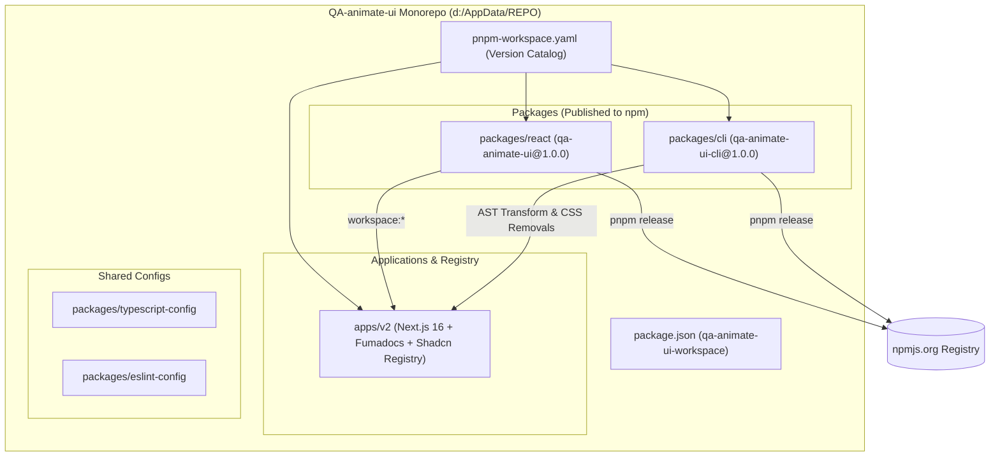

# Tài Liệu Kỹ Thuật (Technical Documentation) — QA-animate-ui

> **QA-animate-ui** là hệ sinh thái UI Animation & Drop-in Primitives dành cho React 19, kết hợp sức mạnh của các thư viện Headless UI (**Radix UI**, **Base UI**, **React Aria**) với công cụ chuyển động **Motion** (`motion/react`) và hệ thống phân phối **Shadcn Registry**.

---

## 1. Tổng Quan Kiến Trúc Hệ Thống (System Architecture)

Dự án được tổ chức theo mô hình **Monorepo** quản lý bởi **pnpm workspaces** (`pnpm-workspace.yaml`) và điều phối tác vụ qua **Turborepo** (`turbo.json`).



### Cấu trúc thư mục cốt lõi

| Đường dẫn | Tên Package | Vai trò kỹ thuật |
| :--- | :--- | :--- |
| `packages/react` | `qa-animate-ui` | Thư viện Core chứa các Animated Primitives, Effects, Buttons, Text Animations, Motion Tokens và Icon Wrapper. |
| `packages/cli` | `qa-animate-ui-cli` | Công cụ dòng lệnh (CLI) sử dụng `@babel/parser` phân tích cú pháp AST để tự động thay thế import và dọn dẹp class CSS xung đột. |
| `apps/v2` | `v2` | Ứng dụng Next.js 16 (App Router + Turbopack + Fumadocs MDX) đóng vai trò cổng tài liệu, trình diễn tương tác (Live Demos) và máy chủ Shadcn Registry (`/r/*.json`). |
| `packages/typescript-config` | `@workspace/typescript-config` | Cấu hình TypeScript chuẩn dùng chung cho Next.js và React Library. |
| `packages/eslint-config` | `@workspace/eslint-config` | Bộ quy tắc kiểm tra mã nguồn ESLint v10 thống nhất toàn monorepo. |

---

## 2. Kiến Trúc Gói Core: `qa-animate-ui` (`packages/react`)

Gói `packages/react` được thiết kế theo triết lý **Zero-Bundle-Bloat** và **Subpath Exports** (`qa-animate-ui/*`), đóng gói bằng **tsdown** (trên nền Rolldown).

### 2.1. Cơ chế Subpath Exports & Codegen Barrels

Trước khi đóng gói (`pnpm build`), script `packages/react/scripts/generate-barrels.mts` tự động quét toàn bộ thư mục con trong `src/primitives/{radix-ui,base-ui,react-aria}` để tạo các file barrel `index.tsx` tái xuất (re-export) toàn bộ API của thư viện gốc, đồng thời ghi đè (override) những component đã được gắn animation.

### 2.2. Các phân hệ bên trong `packages/react/src`

1. **Headless Drop-in Primitives (`src/primitives/`):**
   - **`radix-ui/`**: 21 primitives (`accordion`, `alert-dialog`, `checkbox`, `collapsible`, `context-menu`, `dialog`, `drawer`, `dropdown-menu`, `hover-card`, `menubar`, `navigation-menu`, `popover`, `preview-link-card`, `progress`, `radio-group`, `select`, `slider`, `switch`, `tabs`, `toggle`, `toggle-group`, `tooltip`).
   - **`base-ui/`**: 24 primitives tương thích `@base-ui/react`.
   - **`react-aria/`**: 16 primitives tương thích `react-aria-components`.
2. **Standalone Animated Primitives (`src/primitives/`):**
   - `avatar-group`, `bottom-navigation`, `carousel`, `code-block`, `cursor`, `github-stars`, `input-otp`, `motion-grid`, `pagination`, `pinned-list`, `questionnaire`, `scroll-progress`, `sidebar`, `slot`, `spring`, `tabs`, `tooltip`.
3. **Visual Effects (`src/primitives/effects/`):**
   - `auto-height`, `blur`, `click`, `effect`, `fade`, `highlight`, `image-zoom`, `magnetic`, `particles`, `scroll-fade`, `shine`, `slide`, `theme-toggler`, `tilt`, `zoom`.
4. **Interactive Buttons (`src/primitives/buttons/`):**
   - `button`, `copy`, `icon`, `ripple`.
5. **Typography & Number Animations (`src/primitives/texts/`):**
   - `counting-number`, `gradient`, `highlight`, `morphing`, `rolling`, `rotating`, `scrolling-number`, `shimmering`, `sliding`, `sliding-number`, `splitting`, `swapping`, `typing`.
6. **Motion Tokens & Provider (`src/provider/` & `src/utils/motion/`):**
   - Quản lý tốc độ chuyển động toàn cục (`tempo`), cấu hình giảm chuyển động (`ReducedMotionConfig`), và bộ hằng số vật lý lò xo (`spring`, `ease`, `motionTokens`).
7. **Animated Icon Engine (`src/icons/`):**
   - Cung cấp `IconWrapper`, `useAnimateIconContext` giúp kích hoạt animation trên từng đường nét SVG (`pathLength`, `pathOffset`, `rotate`, `scale`) khi hover, click hoặc lặp vô hạn.

---

## 3. Kiến Trúc Công Cụ CLI: `qa-animate-ui-cli` (`packages/cli`)

Gói `packages/cli` cung cấp lệnh thực thi `qa-animate-ui` (`src/index.ts`) hoạt động như một trình biến đổi mã nguồn tự động (AST Codemod).

### Các lệnh CLI hỗ trợ
- **`qa-animate-ui animate <components...|all>`**:
  - Tự động phát hiện thư mục `components/ui` từ `components.json`.
  - Chuyển đổi các import từ `radix-ui`, `@radix-ui/react-*`, `@base-ui/react/*`, `react-aria-components`, `vaul`, `input-otp`, `embla-carousel-react` sang `qa-animate-ui/primitives/*`.
  - Tự động lọc bỏ các class Tailwind animation tĩnh (`animate-in`, `fade-in`, `zoom-in-95`, `slide-in-from-*`) vốn gây xung đột với animation vật lý của Motion.
- **`qa-animate-ui audit [paths...]`**:
  - Quét toàn bộ dự án để báo cáo những component nào có thể chuyển đổi tự động hoặc cần chỉnh sửa thủ công (hỗ trợ xuất JSON qua `--json`).
- **`qa-animate-ui migrate <components...|all>`**:
  - Công cụ nâng cấp các component từ cấu trúc v1 cũ lên kiến trúc primitives mới.

---

## 4. Pipeline Xây Dựng Shadcn Registry (`apps/v2`)

Ứng dụng `apps/v2` tích hợp bộ script biên dịch tự động trong `apps/v2/scripts/` để xuất ra **789 gói JSON chuẩn Shadcn Registry** vào thư mục `apps/v2/public/r/`:

| Script | Đầu vào (Source) | Đầu ra (`public/r/`) | Chức năng |
| :--- | :--- | :--- | :--- |
| `build-icons.mts` | `registry/icons/*` & `registry/hugeicons/*` | `icons-lucide-*.json` (392), `icons-hugeicons-*.json` (381) | Đóng gói từng icon động kèm metadata từ khóa và tạo file chỉ mục `index.ts`. |
| `build-ui.mts` | `registry/{backgrounds,buttons,components}/*` | `backgrounds-*.json`, `buttons-*.json`, `components-*.json` (16) | Phân tích cú pháp import, tự động suy luận `peerDependencies` qua `react-peers.mts` và xuất JSON. |
| `build-demos.mts` | `demos/*/*.tsx` | `demo-*.json` (148) | Đóng gói các bản demo tương tác để có thể cài đặt hoặc mở trực tiếp. |
| `build-catalog.mts` | `public/r/*.json` | `public/r/registry.json` (789 items) | Tổng hợp danh mục tổng thể của toàn bộ Registry `qa-animate-ui`. |

---

## 5. Hướng Dẫn Tích Hợp & Sử Dụng API (Integration Guide)

### 5.1. Cài đặt từ npm

```bash
# Cài đặt bằng pnpm
pnpm add qa-animate-ui motion

# Hoặc cài đặt bằng npm
npm install qa-animate-ui motion
```

### 5.2. Bảng tra cứu đường dẫn Import (`qa-animate-ui`)

| Nhóm tính năng | Đường dẫn Import (Subpath) | Ví dụ Component / Hook |
| :--- | :--- | :--- |
| **Radix UI Primitives (Barrel)** | `qa-animate-ui/primitives/radix-ui` | `Accordion`, `Dialog`, `DropdownMenu`, `Popover`, `Select`, `Tabs`, `Tooltip`... |
| **Radix UI Primitive (Lẻ)** | `qa-animate-ui/primitives/radix-ui/<name>` | `qa-animate-ui/primitives/radix-ui/dialog` |
| **Base UI Primitives (Barrel)** | `qa-animate-ui/primitives/base-ui` | `Accordion`, `Dialog`, `Menu`, `Popover`, `Select`, `Tabs`, `Toast`... |
| **React Aria Primitives** | `qa-animate-ui/primitives/react-aria` | `Modal`, `Popover`, `Tabs`, `Tooltip`, `ComboBox`, `Select`... |
| **Hiệu ứng (Effects)** | `qa-animate-ui/primitives/effects/<name>` | `blur`, `click`, `fade`, `highlight`, `magnetic`, `particles`, `shine`, `slide`, `tilt`, `zoom` |
| **Nút bấm (Buttons)** | `qa-animate-ui/primitives/buttons/<name>` | `button`, `copy`, `icon`, `ripple` |
| **Chữ & Số (Texts)** | `qa-animate-ui/primitives/texts/<name>` | `counting-number`, `gradient`, `morphing`, `rolling`, `rotating`, `shimmering`, `sliding-number`, `splitting`, `swapping`, `typing` |
| **Provider & Motion Utils** | `qa-animate-ui/provider`, `qa-animate-ui/utils/motion` | `AnimateUIProvider`, `motionTokens`, `ease`, `spring`, `useMotionTokens` |
| **Animated Icons** | `qa-animate-ui/icons` | `IconWrapper`, `useAnimateIconContext`, `getVariants` |

### 5.3. Tuỳ biến cấu hình chuyển động toàn cục với `AnimateUIProvider`

```tsx
import { AnimateUIProvider } from 'qa-animate-ui/provider';

export function AppLayout({ children }: { children: React.ReactNode }) {
  return (
    <AnimateUIProvider
      tempo={1} // 1 = tốc độ chuẩn, >1 = nhanh hơn, <1 = chậm hơn
      checkAnimation="draw" // 'draw' (vẽ nét) hoặc 'pop' (nảy) cho Checkbox/Select/Menu
    >
      {children}
    </AnimateUIProvider>
  );
}
```

---

## 6. Quy Trình Phát Triển, Mở Rộng & Phát Hành (Workflow & Release)

### 6.1. Thêm một Animated Primitive mới vào `qa-animate-ui`
1. Tạo thư mục component mới trong `packages/react/src/primitives/<nhom>/<ten-component>/index.tsx`.
2. Chạy lệnh tạo barrel:
   ```bash
   pnpm --filter=qa-animate-ui gen
   ```
3. Kiểm tra kiểu dữ liệu TypeScript và đóng gói:
   ```bash
   pnpm --filter=qa-animate-ui check-types
   pnpm --filter=qa-animate-ui build
   ```

### 6.2. Thêm một Component / Background / Icon mới vào Registry (`apps/v2`)
1. Tạo thư mục trong `apps/v2/registry/{components,backgrounds,buttons,icons}/<ten>/` gồm `index.tsx` và `meta.json`.
2. Chạy lệnh biên dịch lại Registry:
   ```bash
   pnpm registry:build
   ```

### 6.3. Quy trình kiểm định & phát hành phiên bản mới lên npm (`pnpm release`)
1. Tăng số `"version"` (ví dụ `1.0.1`) trong `packages/react/package.json` và `packages/cli/package.json`.
2. Chạy lệnh phát hành tại thư mục gốc `d:\AppData\REPO`:
   ```bash
   pnpm release
   ```
3. Commit và đẩy mã nguồn lên Git repository:
   ```bash
   git add -A
   git commit -m "chore(release): v1.0.1"
   git push
   ```

---

## 7. Đặc Tả Chi Tiết Từng Nhóm Component & Props (Component Reference)

### 7.1. Nhóm Headless UI Primitives (`radix-ui`, `base-ui`, `react-aria`)

Mọi primitive trong `packages/react/src/primitives` đều kế thừa toàn bộ props của thư viện gốc và bổ sung cơ chế điều phối `AnimatePresence` + `motion` thông qua các bộ máy nội bộ trong `packages/react/src/internal/`:

| Cơ chế nội bộ (`src/internal/`) | Các Primitive áp dụng | Hành vi chuyển động (Motion Behavior) |
| :--- | :--- | :--- |
| `modal-motion.tsx` | `Dialog`, `AlertDialog`, `Sheet`, `Modal` | Overlay mờ dần (`opacity`), Content phóng nhẹ kèm trượt theo hướng `from` (`top`, `bottom`, `left`, `right`) và hiệu ứng `blur`. |
| `anchored.tsx` | `Popover`, `HoverCard`, `Tooltip`, `Select`, `Combobox` | Tự động tính toán `transformOrigin` từ biến CSS của Radix/Base UI/React Aria, phóng từ điểm neo với lò xo vật lý (`spring`). |
| `menu-handoff.tsx` | `DropdownMenu`, `ContextMenu`, `Menubar`, `NavigationMenu` | Chuyển giao mượt mà (handoff) vệt sáng `Highlight` khi di chuột qua các `MenuItem` và trượt mượt giữa các menu con (`SubContent`). |
| `disclosure-panel.tsx` | `Accordion`, `Collapsible`, `Disclosure` | Đo chiều cao thực tế qua `ResizeObserver` để animate `height: 0 -> auto` mượt mà kèm làm mờ nội dung (`mask-image` / `blur`). |
| `item-indicator.tsx` | `Checkbox`, `RadioGroup`, `SelectItem`, `MenuCheckboxItem` | Hỗ trợ 2 chế độ từ `AnimateUIProvider`: `checkAnimation="draw"` (vẽ nét SVG `pathLength`) hoặc `"pop"` (phóng nảy). |

---

### 7.2. Nhóm Visual Effects (`qa-animate-ui/primitives/effects/*`)

| Component | Import Path | Props chính | Mô tả kỹ thuật |
| :--- | :--- | :--- | :--- |
| **`Effect` / `Effects`** | `qa-animate-ui/primitives/effects/effect` | `fade`, `slide`, `zoom`, `blur`, `delay`, `inView`, `inViewOnce` | Kết hợp linh hoạt nhiều hiệu ứng xuất hiện (enter animation) trên cùng một phần tử hoặc danh sách phần tử (`stagger`). |
| **`Highlight`** | `qa-animate-ui/primitives/effects/highlight` | `mode` (`'children'` \| `'parent'`), `hover`, `click`, `exitDelay`, `controlledItems` | Tạo nền trượt (floating indicator) bám theo phần tử đang active hoặc đang hover (dùng trong Tabs, Navbar, Segmented Control). |
| **`Magnetic`** | `qa-animate-ui/primitives/effects/magnetic` | `strength` (`0..1`), `range` (`px`), `onlyOnHover`, `springOptions` | Tính khoảng cách tâm phần tử tới con trỏ chuột và hút phần tử theo lực đàn hồi lò xo. |
| **`Tilt`** | `qa-animate-ui/primitives/effects/tilt` | `maxTilt` (`deg`), `perspective` (`px`), `scale` | Nghiêng thẻ 3D (`rotateX`, `rotateY`) theo vị trí di chuột trên bề mặt thẻ. |
| **`Particles`** | `qa-animate-ui/primitives/effects/particles` | `count`, `radius`, `spread`, `duration`, `holdDelay` | Phát tán các hạt xung quanh phần tử khi kích hoạt (ví dụ nút Like, GitHub Stars). |
| **`Shine`** | `qa-animate-ui/primitives/effects/shine` | `deg`, `duration`, `loop`, `loopDelay`, `enableOnHover` | Quét vệt sáng chéo qua bề mặt thẻ hoặc nút bấm. |
| **`AutoHeight`** | `qa-animate-ui/primitives/effects/auto-height` | `deps`, `transition` | Tự động đo và làm mượt sự thay đổi chiều cao khi nội dung bên trong biến đổi động. |
| **`ScrollFade`** | `qa-animate-ui/primitives/effects/scroll-fade` | `size`, `shrink`, `blur` | Tạo hiệu ứng thu nhỏ và mờ dần ở hai đầu danh sách cuộn. |

---

### 7.3. Nhóm Typography & Number Animations (`qa-animate-ui/primitives/texts/*`)

| Component | Import Path | Props chính | Ứng dụng thực tế |
| :--- | :--- | :--- | :--- |
| **`CountingNumber`** | `qa-animate-ui/primitives/texts/counting-number` | `number`, `fromNumber`, `decimalPlaces`, `padStart`, `inView` | Đếm số tăng/giảm mượt mà theo thời gian thực cho Dashboard, KPI, thống kê. |
| **`SlidingNumber`** | `qa-animate-ui/primitives/texts/sliding-number` | `number`, `padStart`, `thousandSeparator`, `decimalSeparator` | Cuộn từng chữ số theo trục dọc giống đồng hồ cơ học (Odometer) khi giá trị thay đổi. |
| **`TypingText`** | `qa-animate-ui/primitives/texts/typing` | `text` (`string \| string[]`), `cursor`, `loop`, `holdDelay`, `duration` | Hiệu ứng gõ phím từng ký tự kèm con trỏ nhấp nháy, hỗ trợ lặp qua mảng nhiều câu. |
| **`MorphingText`** | `qa-animate-ui/primitives/texts/morphing` | `text` (`string[]`), `loop`, `holdDelay` | Biến hình chữ (SVG threshold blur morph) mượt mà giữa các từ khóa. |
| **`ShimmeringText`** | `qa-animate-ui/primitives/texts/shimmering` | `text`, `wave`, `duration`, `color`, `shimmeringColor` | Chữ ánh kim chạy sáng ngang hoặc lượn sóng 3D (`wave={true}`). |
| **`SplittingText`** | `qa-animate-ui/primitives/texts/splitting` | `text`, `type` (`'chars'` \| `'words'` \| `'lines'`), `animation` (`'default'` \| `'vibe'` \| `'writing'`) | Tách văn bản thành từng ký tự/từ/dòng để chạy hiệu ứng xuất hiện tuần tự. |
| **`RotatingText` / `SwappingText`** | `qa-animate-ui/primitives/texts/rotating` | `text` (`string[]`), `duration`, `y`, `stagger` | Xoay vòng danh sách các từ khóa nổi bật trong câu tiêu đề Hero. |

---

### 7.4. Nhóm Registry Components & Backgrounds (`apps/v2/registry/`)

Các thành phần giao diện hoàn chỉnh nằm trong `apps/v2/registry/` được biên dịch sẵn ra `apps/v2/public/r/*.json`:

- **Animated Backgrounds (`registry/backgrounds/`):**
  - `backgrounds-bubble`, `backgrounds-fireworks`, `backgrounds-glyph`, `backgrounds-gravity-stars`, `backgrounds-gradient`, `backgrounds-hexagon`, `backgrounds-hole`, `backgrounds-stars`, `backgrounds-topography`.
- **Animated Buttons (`registry/buttons/`):**
  - `buttons-button`, `buttons-copy`, `buttons-flip`, `buttons-github-stars`, `buttons-icon`, `buttons-liquid`, `buttons-ripple`, `buttons-theme-toggler`.
- **Composite UI Components (`registry/components/`):**
  - `components-avatar-group`, `components-bottom-navigation`, `components-code-tabs`, `components-cursor`, `components-motion-carousel`, `components-motion-grid`, `components-page-transition`, `components-pinned-list`, `components-scroll-progress`, `components-spring-element`.

---

## 8. Hướng Dẫn Triển Khai Trang Docs & Shadcn Registry (`apps/v2`) Lên Vercel

### Bước 1: Đẩy mã nguồn lên GitHub cá nhân

```bash
git remote add origin https://github.com/<username>/QA-animate-ui.git
git push -u origin main
```

### Bước 2: Cấu hình Project trên Vercel

1. Truy cập `https://vercel.com/new` và chọn **Import** repository `QA-animate-ui` từ GitHub.
2. Tại màn hình **Configure Project**, thiết lập:
   - **Framework Preset:** `Next.js`
   - **Root Directory:** `apps/v2`
   - **Install Command:** `pnpm install`
   - **Build Command:** `pnpm build` (tự động chạy `pnpm registry && next build`)
3. **Environment Variables (Tuỳ chọn):**
   - `NEXT_PUBLIC_V2_URL`: Tên miền Vercel của bạn (ví dụ `https://qa-animate-ui.vercel.app`).
   - `GITHUB_TOKEN`: (Tuỳ chọn) Personal Access Token của GitHub.
4. Bấm **Deploy**.

### Bước 3: Sử dụng Shadcn Registry từ tên miền Vercel của bạn

```bash
npx shadcn@latest add https://qa-animate-ui.vercel.app/r/backgrounds-bubble.json
npx shadcn@latest add https://qa-animate-ui.vercel.app/r/buttons-liquid.json
npx shadcn@latest add https://qa-animate-ui.vercel.app/r/icons-lucide-sparkles.json
```
